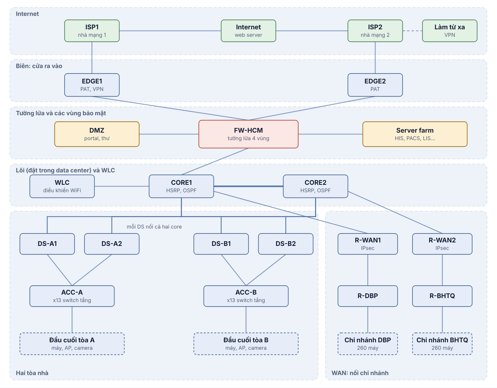
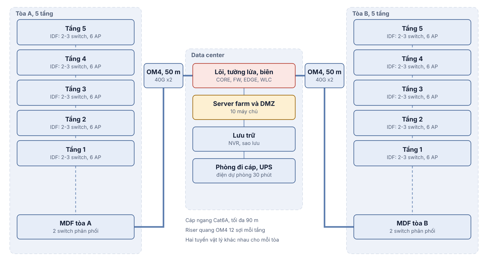
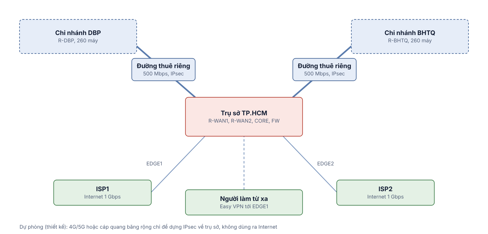

# Assignment 2 · Thiết kế mạng bệnh viện chuyên khoa

**Môn Mạng máy tính · HK261**\
**Nhóm:** [Điền họ tên và MSSV]\
**Ngày lập:** 03/11/2026

## 1. Phân tích và khảo sát

HCM có hai tòa, mỗi tòa 5 tầng × 10 phòng. Bố trí 290 máy trạm ở A và 310 ở B, 10 máy chủ tại phòng dữ liệu cách mỗi tòa khoảng 50 m. DBP và BHTQ mỗi nơi có 2 tầng, 260 máy trạm và 2 máy chủ. Đặt MDF và phòng IT tại tầng 1 chi nhánh. Dự phòng tăng trưởng 20% sau 5 năm.

Tại HCM, mỗi tầng có IDF, mỗi tòa có một cặp distribution và phòng dữ liệu có cặp core. Hai tuyến quang giữa mỗi tòa và phòng dữ liệu đi qua hai ống độc lập. Cáp ngang đi trong máng và trần giả, đánh nhãn theo tầng, tủ và cổng. Bố trí UPS, kiểm soát ra vào và làm mát cho phòng máy. Chi nhánh dùng router định tuyến VLAN và switch access theo tầng.

| Khảo sát | Nội dung cần chốt |
|---|---|
| Mặt bằng và cáp | Số ổ mạng/phòng, chiều dài tuyến ngang ≤ 90 m, shaft, tuyến quang độc lập, vị trí rack và patch panel |
| Điện và môi trường | PoE, UPS, nguồn dự phòng, tản nhiệt, khói, độ ẩm và khóa tủ |
| WiFi | Vật liệu tường, vùng che chắn, số client đồng thời, nhiễu và vùng chuyển AP |
| Dịch vụ | RTO/RPO của HIS/PACS, lưu lượng DICOM, dữ liệu cần giữ tại chi nhánh, đối tượng VPN |
| Camera | Điểm mù, lối vào, sảnh, hành lang, bãi xe, thời gian lưu và quyền xem |
| Nhà mạng | Hai tuyến vào độc lập, điểm bàn giao, băng thông cam kết, độ trễ và SLA |

Vùng tải cao gồm tiếp đón/ngoại trú (mật độ người dùng), chẩn đoán hình ảnh (PACS), cấp cứu (độ sẵn sàng), server farm và NVR. Tách VLAN theo khoa và chức năng. Dùng uplink 10 GbE cho access, 40 GbE cho distribution–core, ưu tiên giao dịch HIS khi WAN nghẽn và chuyển sao lưu lớn sang ngoài giờ.

WiFi dự kiến 30 AP mỗi tòa và 14 AP mỗi chi nhánh, điều chỉnh theo khảo sát sóng. Nhân viên dùng SSID riêng, xác thực 802.1X qua RADIUS và quyền theo vai trò. Khách dùng SSID/VLAN riêng, cô lập client, giới hạn tốc độ và chỉ có quyền DNS được chỉ định cùng Internet. AP chi nhánh chuyển frame vào VLAN cục bộ. Lưu lượng ra Internet tiếp tục đi qua WAN về HCM.

## 2. Topology, thiết bị, địa chỉ và cabling

| Khu vực | Thiết bị và số lượng thiết kế |
|---|---|
| HCM, biên và lõi | 2 router Internet, 2 router WAN, 2 NGFW HA, 2 core L3, 4 distribution L3, 2 WLC |
| HCM, truy nhập | 13 switch PoE 48 cổng mỗi tòa, 30 AP WiFi 6 mỗi tòa, 46 camera mỗi tòa |
| HCM, dịch vụ | 2 switch ToR, 2 switch DMZ, 7 máy chủ nội bộ, 3 máy chủ DMZ và 2 thiết bị lưu trữ |
| Mỗi chi nhánh | 1 router IPsec, 9 switch PoE 48 cổng, 14 AP, 26 camera, 2 máy chủ cục bộ |
| Cabling | Cat6A ngang, OM4 riser, OM4/OS2 liên tòa, patch panel, module SFP+/QSFP+ theo số cổng, rack và UPS |

Phân bổ sơ bộ 3–3–3–2–2 switch mỗi tòa và 5–4 ở hai tầng chi nhánh. Kiểm tra lại phân bổ theo số thiết bị thực tế từng tầng. Các giá trị 584 cổng ở A, 608 ở B và 408 mỗi chi nhánh đã gồm tăng trưởng 20%. Cộng công suất PoE theo thiết bị thực tế và giới hạn công suất mỗi switch trước khi chọn model. Các AP có uplink 2,5 GbE có thể chạy ở 1 GbE nếu tải thiết kế phù hợp. Khu mật độ cao cần cổng multigig theo kết quả khảo sát.

### Nhánh GPON

Dùng GPON cho camera ngoài trời và ki-ốt/phòng chờ ở các cụm phân tán. OLT đặt trong MDF phòng dữ liệu và uplink về core. Mỗi tòa có một cổng PON, một splitter 1:8 trong hộp phân phối và tối đa 8 ONT tại cụm đầu cuối. Tuyến dùng OS2, qua ODF/patch panel và splitter thụ động. Chốt công suất quang theo tổng suy hao cáp, splitter, đầu nối và dự phòng, đối chiếu optical budget của cặp OLT/ONT trước nghiệm thu. Cấu hình uplink trunk, ánh xạ cổng ONT vào VLAN CCTV hoặc VLAN kiosk theo vị trí và áp QoS theo thuê bao. ONT cần nguồn cục bộ. Cụm camera dùng switch PoE và UPS tại chỗ. Các uplink campus 10/40 GbE giữ riêng cho tải tập trung.

### IP và định tuyến

HCM dùng 10.10.0.0/16, DBP dùng 10.20.0.0/16, BHTQ dùng 10.30.0.0/16. Tại HCM, A dùng 10.10.0.0/20, B dùng 10.10.16.0/20, dịch vụ dùng 10.10.32.0/20. Các đường point-to-point dùng /30 từ 172.16.0.0/16. Cặp distribution chạy HSRP và đặt STP root tương ứng gateway active. OSPF area 0 trao đổi route nội bộ và chi nhánh. CORE1 công bố default route từ firewall. WAN là hub-and-spoke, DBP–BHTQ và Internet chi nhánh đi qua HCM.

### Dịch vụ, VPN và camera

Server farm chạy HIS, LIS, PACS, AD/DNS, giám sát và lưu trữ. Dịch vụ ứng dụng dùng phần mềm được cấp phép theo hợp đồng hoặc phần mềm mở theo khả năng tích hợp và vận hành. CRM/office dùng quyền theo vai trò. Portal và mail gateway nằm trong DMZ. Thiết kế firewall mặc định chặn kết nối khởi tạo từ ngoài và DMZ vào nội bộ, với ngoại lệ dịch vụ đích cụ thể. Site-to-site IPsec bảo vệ các luồng dữ liệu ứng dụng được chọn. VPN nhân viên từ xa có pool riêng, xác thực đa yếu tố khi triển khai thật và giới hạn truy cập HIS.

Camera gắn ở cửa ra vào, hành lang, sảnh và bãi xe. Tách VLAN CCTV, ghi về NVR tại mỗi site và giới hạn quyền xem cho tổ an ninh. Với giả định 4 Mbps/camera và ghi liên tục 30 ngày, HCM cần khoảng 119,2 TB dữ liệu thô, mỗi chi nhánh cần khoảng 33,7 TB. Chọn dung lượng khả dụng sau RAID lớn hơn số này và cộng dự phòng. Xem từ xa qua mạng quản trị, tránh đưa trực tiếp cổng camera ra Internet.

## 3. Throughput, WAN và phương án chi phí

Mbps cao điểm = MB/ngày × 8 × 0,8 / (3 × 3600). Nhân 1,2 cho năm thứ năm. Mô hình dùng 500/100 MB xuống/lên mỗi máy trạm, 1000/2000 MB mỗi máy chủ, 500 MB xuống mỗi khách và giả định 300 khách tại HCM, 120 mỗi chi nhánh. Lưu lượng HIS, PACS và xem camera là giả định bổ sung.

| Site | Internet xuống/lên hiện tại (Mbps) | WAN xuống/lên sau 5 năm (Mbps) |
|---|---:|---:|
| HCM | 272,6 / 47,4 | Đầu mối WAN |
| DBP | 113,8 / 17,8 | 153,5 / 41,5 |
| BHTQ | 113,8 / 17,8 | 153,5 / 41,5 |
| Tổng Internet sau 5 năm | 600,2 / 99,6 | Hai đường Internet tại HCM |

Camera HCM tạo 368 Mbps liên tục. Tổng lưu lượng qua firewall ước tính 1,918 Gbps với tải tăng trưởng. Chọn NGFW có thông lượng tối thiểu 4 Gbps với tính năng kiểm tra cần dùng. Một uplink access cần khoảng 2,4 Gbps theo hệ số 20:1. Mỗi distribution cần khoảng 32,5 Gbps lên core theo hệ số 4:1.

Hai DSL theo đề là phương án so sánh. Ngay cả khi giả định mỗi DSL đạt 100 Mbps chiều xuống, hai đường cộng lại vẫn thấp hơn 600,2 Mbps. Đề xuất hai đường fiber doanh nghiệp 1 Gbps đối xứng, mỗi đường gánh được tải dự kiến khi đường kia mất. Dùng theo dõi đường đi và chia phiên theo đường egress trong thiết kế thật.

| Công nghệ WAN | Ưu điểm | Đánh đổi |
|---|---|---|
| Kênh thuê riêng L2 + IPsec | Đối xứng, SLA, độ trễ dễ dự báo, kiểm soát route | Chi phí thuê bao và router mã hóa, một đường/site |
| MPLS L3VPN | QoS/SLA, nhà mạng vận hành routing | Phí cao, phụ thuộc nhà mạng |
| SD-WAN trên DIA | Chọn đường theo ứng dụng, quản trị tập trung | License/controller, cần đa đường nền |
| SD-WAN hoặc IPsec trên broadband | Triển khai nhanh và chi phí thấp | Biến động độ trễ, SLA hạn chế |
| Metro Ethernet/VPLS | Kết nối L2, băng thông đối xứng tùy gói | Phạm vi cung cấp và miền broadcast |

Chọn kênh L2 500 Mbps mỗi chi nhánh. Bảng sau là kịch bản ngân sách giả định để so sánh, đơn vị triệu đồng/tháng cho cả hệ thống, chưa gồm VAT, lắp đặt, thiết bị và license. Thay giả định bằng báo giá theo địa chỉ trước khi mua.

| Phương án | Giả định đơn giá | Tổng/tháng |
|---|---|---:|
| Internet HCM | 2 × 3 cho fiber 1 Gbps | 6 |
| WAN L2 500 Mbps | 2 × 15 | 30 |
| WAN MPLS 500 Mbps | 2 × 22 | 44 |
| WAN SD-WAN trên DIA | 2 × 10 đường nền + 3 × 2 quản lý | 26 |
| WAN IPsec trên broadband | 2 × 3 đường chi nhánh | 6 |

## 4. Mô phỏng

File `Simulation/hospital-network.pkt` đại diện ba site, dùng router 2911, switch L3 3650, access 2960 và ASA 5506-X. Cisco Packet Tracer 9.0.1 đã mở được file này. Các bảng cấu hình và đấu nối sinh từ mô hình Python. Kiểm tra tĩnh xác nhận 51 subnet, 16 liên kết point-to-point và 22 cấu hình.

Mô phỏng dùng một firewall nối CORE1 và AP độc lập cho khách. Hai tuyến /1 chia theo đích Internet, mỗi tuyến có đường dự phòng. GPON, HA firewall, phủ sóng WiFi và 802.1X thuộc thiết kế triển khai. Các ngoại lệ TCP trong ACL lab cần được siết lại hoặc thay bằng firewall theo dõi phiên trước khi triển khai thực tế.

## 5. Kiểm thử và demo

Bảng dưới ghi kết quả nhóm đã mô tả trong tài liệu mô phỏng của repo. Kết quả chạy lại ngày 03/11/2026 được ghi riêng bên dưới.

| Yêu cầu | Thao tác demo | Kết quả ghi trong repo |
|---|---|---|
| Cùng VLAN | Hai PC-A-OUTPATIENT ping nhau | Thông |
| Khác VLAN | PC-B-TRAINING → PC-A-PHARMACY | 4/4 |
| HCM ↔ chi nhánh | PC-A-PHARMACY ping 10.20.0.11 và 10.30.0.11 | 4/4 mỗi đích, traceroute DBP đi qua router WAN |
| DMZ | LAN mở http://10.10.36.82, TELE-PC mở http://203.0.113.3 | Cả hai mở được |
| Guest bị chặn vào LAN | GUEST-PHONE ping 10.10.20.11 và 10.10.36.66 | Mất 100% gói, guest vẫn mở web Internet |
| Web Internet | PC-A-PHARMACY mở http://192.0.2.10 | Mở được |

### Kiểm tra lại file đã lưu

Sau khi mạng hội tụ, log `Simulation/pt/retest.log` ghi ping cùng VLAN 3/3, HCM → DBP 3/3, HCM → BHTQ 3/3, khác VLAN 2/3 và camera → HIS 0/3 theo chính sách chặn. Ca khác VLAN sử dụng địa chỉ DHCP thực tế của PC-A-PHARMACY là 10.10.3.165. Log chẩn đoán cho thấy hai core và hai router WAN đều có láng giềng OSPF ở trạng thái FULL. Ping tới máy chủ Internet từ PC-A-OUTPATIENT-2 đạt 1/3 và DBP → BHTQ đạt 0/3 trong lần chạy này.

Ca HTTP từ TELE-PC tới 203.0.113.3 đã đạt trên bản mô phỏng đã lưu. ISP1 định tuyến IP public của portal tới EDGE1. Firewall dùng tuyến /32 về TELE-PC qua EDGE1 để gói trả lời đi đúng router NAT. Ảnh xác nhận nằm tại `Simulation/pt/dmz-http.png`.

HTTP Internet từ LAN và cách ly WiFi khách chưa được chạy lại trên bản lưu mới. Kết quả của nhóm cho hai ca này nằm trong bảng phía trên.

Để minh họa tài liệu Reference, truy cập địa chỉ public của portal từ TELE-PC và kiểm tra `show ip nat translations` tại EDGE1. Log trong repo có bản dịch từ 203.0.113.3:80 tới 10.10.36.82:80 với nguồn ngoài 198.51.101.10. Kiểm tra PAT trên cả hai edge bằng hai đích thuộc hai dải /1. Dùng `show ip ospf neighbor`, `show standby brief` và `show crypto ipsec sa` để kiểm tra định tuyến, dự phòng gateway và bộ đếm mã hóa.

## 6. Đánh giá và hướng phát triển

Thiết kế có cặp core/distribution, uplink dự phòng và hai đường Internet. Trong mô phỏng, mất CORE1 hoặc firewall có thể làm mất đường ra Internet và vùng dịch vụ. Mỗi chi nhánh vẫn phụ thuộc một kênh WAN. Phép thử ngắt đoạn EDGE–firewall không đại diện cho sự cố upstream khi link vẫn lên. Cần đo thời gian hội tụ, thử failback, theo dõi upstream và xác nhận khả năng phục vụ của một đường khi dự phòng.

VLSM theo site cho phép tăng quy mô và tóm tắt route. Cấu hình sinh tự động giúp đồng bộ tài liệu. Các giả định AP, PoE, cáp, lưu trữ và chi phí phải được xác minh tại công trình. Vùng khách, thiết bị y tế và camera cần thử cả chiều cho phép và chiều cấm. Cần xác nhận DNS bằng hostname, kiểm thử TCP từ DMZ vào LAN và ghi rõ chênh lệch giữa rule lab và chính sách triển khai.

Ưu tiên phát triển đường WAN dự phòng về HCM, HA firewall và core, hệ thống giám sát đường truyền, khôi phục sao lưu định kỳ và xác thực quản trị tập trung. Thiết kế cổng dự phòng, nguồn UPS và tuyến cáp độc lập để thay thiết bị trong thời gian bảo trì.

## 7. Hồ sơ nộp và tài liệu tham khảo

Điền thông tin nhóm trên bìa. Hoàn thành các ca nghiệm thu ở mục 5 trước khi nộp PDF cùng file Packet Tracer qua BKeL. Kiểm tra hạn trên BKeL và chuẩn bị bản in cho buổi báo cáo.

- Đề Assignment 2 – Network Design and Simulation for a Critical Large Hospital.
- HCMUT, A Multi-Site Network w. Address Translation, hướng dẫn DHCP, OSPF, NAT/PAT và truy vết PDU.
- Hồ sơ kỹ thuật trong repo gồm `docs/01–07`, `docs/generated` và `Configurations`.
