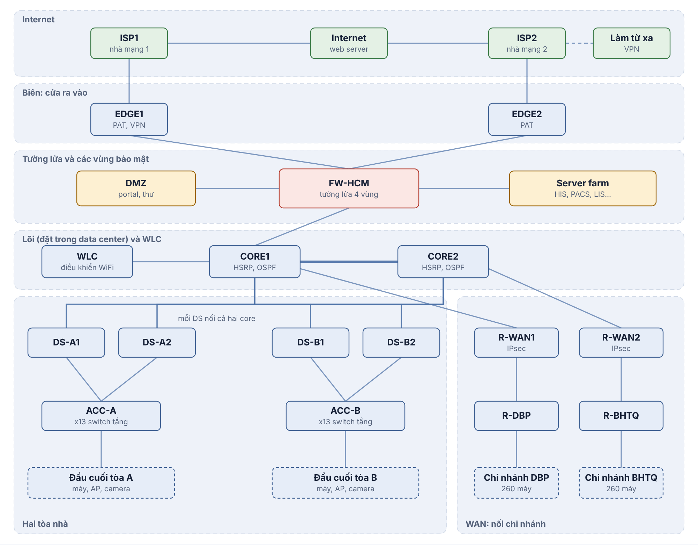
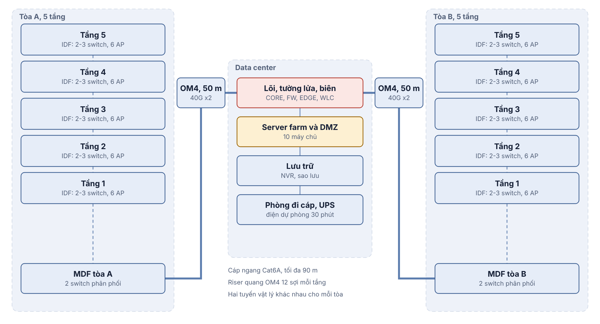
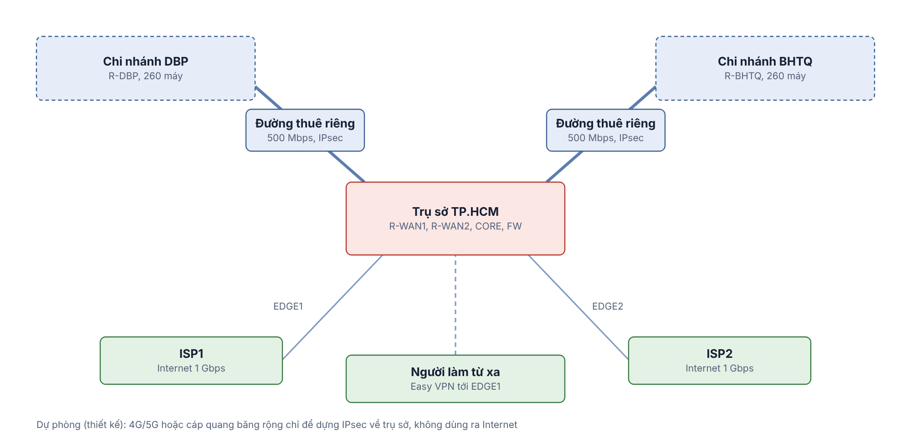

# 03 - Thiết kế chi tiết (Bước 2)

## 1. Danh sách thiết bị

Chủng loại và thông số tối thiểu; model cụ thể chọn theo báo giá nhà cung cấp. Cột cuối là thiết bị dùng trong Packet Tracer.

### Trụ sở TP.HCM

| Vai trò | SL | Thông số tối thiểu | Packet Tracer |
|---|---|---|---|
| Edge router | 2 | 2 cổng GE, NAT, IPsec/Easy VPN, hiệu năng NAT thỏa 1 Gbps | Cisco 2911 |
| NGFW (cặp HA active/standby) | 2 | Tối thiểu 5 cổng 10 GbE, IPS bật đạt tối thiểu 4 Gbps, lọc URL/DNS, SSL inspection | ASA 5506-X |
| Core L3 | 2 | 24 cổng 10 GbE SFP+, 4 cổng 40 GbE QSFP+, HSRP, OSPF | Catalyst 3650-24PS |
| Distribution L3 | 4 | 16 cổng 10 GbE SFP+ trở lên, 2 cổng 40 GbE, HSRP, OSPF | Catalyst 3650-24PS |
| Access switch | 26 | 48 cổng 1 GbE PoE+, 4 cổng 10 GbE SFP+ | Catalyst 2960-24TT (đại diện) |
| WLC (cặp HA) | 2 | Hỗ trợ tối thiểu 100 AP mỗi thiết bị | WLC |
| Access point | 60 | WiFi 6, PoE, 2.5 GbE | LAP-PT |
| WAN router | 2 | 2 cổng GE, IPsec site-to-site | Cisco 2911 |
| Switch server farm (ToR) | 2 | 24 cổng 10 GbE, LACP | 2960-24TT |
| Switch DMZ | 2 | 12 cổng 1 GbE | 2960-24TT |
| Server | 10 | 7 trong server farm, 3 trong DMZ | Server-PT |
| Thiết bị lưu trữ | 2 | NVR camera và thiết bị sao lưu | Server-PT |
| UPS | theo tải | Phòng máy tối thiểu 30 phút | không |

### Mỗi chi nhánh (DBP, BHTQ)

| Vai trò | SL | Thông số tối thiểu | Packet Tracer |
|---|---|---|---|
| Router biên và VPN | 1 | 2 cổng GE, router-on-a-stick, IPsec, ACL | Cisco 2911 |
| Access switch | 9 | 48 cổng 1 GbE PoE+ | 2960-24TT (2 chiếc đại diện) |
| Access point | 14 | WiFi 6, chế độ chuyển mạch cục bộ | LAP-PT |
| Server cục bộ | 2 | Dữ liệu tạm và NVR | Server-PT |

Chi nhánh có từ 5 thiết bị mạng như đề yêu cầu (1 router, 9 switch, 14 AP). Số switch được tính ở `generated/sizing.md`.

## 2. Kế hoạch địa chỉ IP

Chi tiết do `tools/design.py` sinh và kiểm tra tự động (không trùng, đủ chỗ, khớp tổng máy trạm):

- `generated/ip-plan.md`: bảng VLAN và subnet cho cả ba site.
- `generated/links.md`: các liên kết point-to-point, địa chỉ công cộng mô phỏng, static NAT, server, loopback.

Quy ước: mỗi site một khối /16 (10.10 trụ sở, 10.20 DBP, 10.30 BHTQ); trong trụ sở tòa A dùng 10.10.0.0/20, tòa B 10.10.16.0/20, dịch vụ dùng chung 10.10.32.0/20. Hạ tầng dùng 172.16.0.0/16 chia /30, loopback router-id ở 172.16.255.0/24. VLSM cấp địa chỉ từ subnet lớn đến nhỏ, mỗi subnet có 20% dự phòng tăng trưởng và 3 địa chỉ cho gateway. Địa chỉ `.1` là gateway ảo HSRP, `.2` và `.3` là hai distribution.

## 3. Định tuyến và dự phòng

- OSPF area 0 giữa core, distribution, WAN router và router chi nhánh; mọi SVI là passive.
- CORE1 có route mặc định tĩnh về firewall và quảng bá `default-information originate`; CORE1 cũng có route tĩnh tới subnet server farm và DMZ (sau firewall) và phân phối vào OSPF.
- Firewall có hai route mặc định bằng nhau qua EDGE1 và EDGE2 (chia tải ECMP trên hai giao diện outside); mất liên kết tới một EDGE thì route đó biến mất và lưu lượng đi qua EDGE còn lại.
- HSRP: nhóm theo thứ tự VLAN; distribution 1 ưu tiên cao cho các VLAN thứ tự lẻ, distribution 2 cho thứ tự chẵn; STP root theo cùng quy tắc để lưu lượng không đi vòng.
- DHCP: cấp tại distribution/core cho VLAN do thiết bị đó phục vụ; mỗi VLAN chia hai nửa dải cho hai thiết bị (split scope) nên một thiết bị hỏng thì thiết bị kia vẫn cấp được địa chỉ.
- Giới hạn trong thiết kế thật: cặp firewall HA nối vào cả hai core; mô phỏng Packet Tracer dùng một firewall duy nhất nối vào CORE1.

## 4. Sơ đồ cáp có cấu trúc

| Đoạn | Môi trường | Khoảng cách | Ghi chú |
|---|---|---|---|
| Phòng làm việc tới IDF (cáp ngang) | Cat6A | Tối đa 90 m | Cat6A đạt 10G tới 100 m; Cat6 chỉ khoảng 55 m với 10G nên không chọn |
| IDF tầng tới MDF tòa (riser) | Cáp quang OM4 | Dưới 50 m | 12 sợi mỗi tầng |
| MDF tòa tới DC | OM4 hoặc OS2 | 50 m | Hai tuyến vật lý khác nhau, mỗi tuyến một đôi 40G |
| DC nội bộ | DAC/AOC và OM4 | Dưới 10 m | Rack server farm, rack core, rack firewall |
| DC tới nhà mạng Internet | Cáp quang đơn mode của nhà mạng | Theo nhà mạng | Hai nhà mạng vào hai hướng khác nhau |
| Chi nhánh | Cat6A ngang, OM4 riser | như trên | Mỗi chi nhánh một MDF |

Quy ước thêm: mỗi vùng làm việc có tối thiểu hai ổ cắm; nhãn cáp theo mã tầng-tủ-cổng; toàn bộ cáp ngang thử nghiệm bằng máy đo trước khi nghiệm thu. Số cổng cần theo tòa: A 584, B 608 (đã cộng 20% dự phòng), xem `generated/sizing.md`.

Sơ đồ logic:

Sơ đồ vật lý:

Sơ đồ WAN:

## 5. Sơ đồ WAN

- **Đường thuê riêng**: R-WAN1 tại trụ sở nối R-DBP, R-WAN2 nối R-BHTQ; mỗi đường thuê riêng được mã hóa IPsec (site-to-site VPN) và chạy OSPF để học route.
- Lưu lượng DBP đi BHTQ qua trụ sở (hub-and-spoke); mọi lưu lượng Internet của chi nhánh cũng đi qua trụ sở như đề yêu cầu.
- Dự phòng đường truyền (chỉ thiết kế, không mô phỏng): thêm đường 4G/5G hoặc cáp quang băng rộng ở chi nhánh chỉ để dựng đường hầm IPsec dự phòng về trụ sở, không dùng để ra Internet.
- SD-WAN và MPLS được so sánh ở tài liệu 01 và 04; chọn đường thuê riêng vì băng thông đối xứng, riêng tư, có SLA, chi phí dự đoán được.

Bảng đấu nối đầy đủ để dựng mô phỏng: `generated/wiring.md`.
