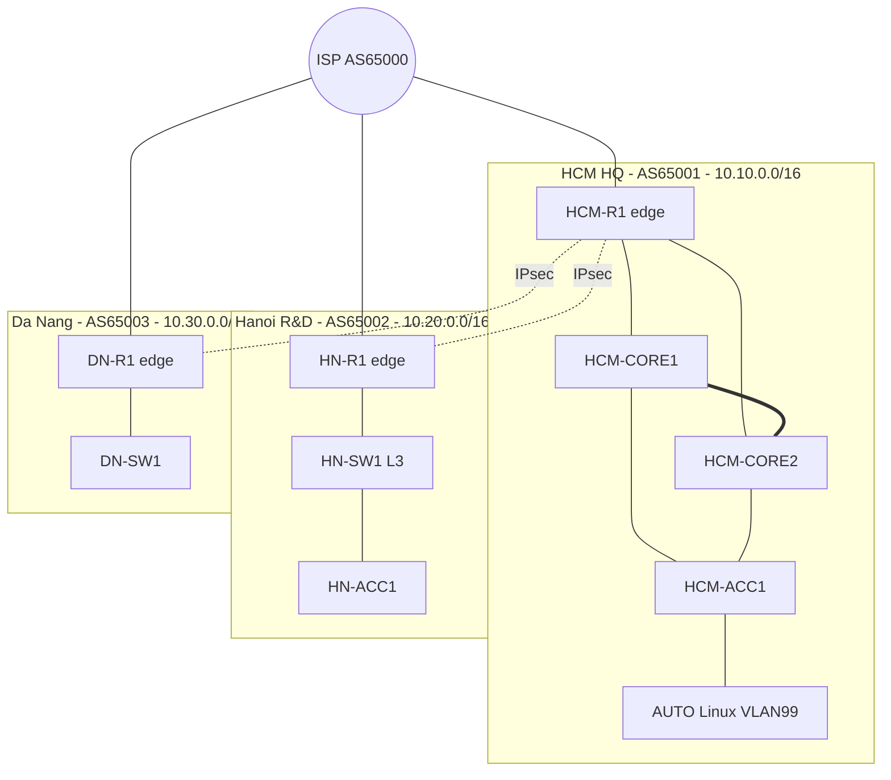

# 05 - Topology và thiết kế địa chỉ (bản nháp)

Bản có hình đầy đủ: `05_topology.html` (mở bằng trình duyệt) hoặc trang artifact đã publish.
Đây là bản nháp, chờ nhóm duyệt. Chưa chốt: nền tảng lab thật, nguồn image Cisco, các tính năng image hỗ trợ (DAI, QoS, IKEv2).

## Sơ đồ

Tổng 11 node: HCM 4 + AUTO, Hanoi 3, Da Nang 2, ISP 1.

## VLAN và IP

| Site | VLAN | Tên | Subnet | Gateway |
|---|---|---|---|---|
| HCM | 10 | Staff A | 10.10.0.0/22 | 10.10.0.1 |
| HCM | 11 | Staff B | 10.10.4.0/22 | 10.10.4.1 |
| HCM | 20 | Servers (DHCP, DNS) | 10.10.16.0/24 | 10.10.16.1 |
| HCM | 30 | Voice | 10.10.17.0/24 | 10.10.17.1 |
| HCM | 99 | Management | 10.10.99.0/24 | 10.10.99.1 |
| HN | 10 | R&D A | 10.20.0.0/22 | 10.20.0.1 |
| HN | 11 | R&D B | 10.20.4.0/22 | 10.20.4.1 |
| HN | 20 | Lab servers | 10.20.16.0/24 | 10.20.16.1 |
| HN | 30 | Voice | 10.20.17.0/24 | 10.20.17.1 |
| HN | 99 | Management | 10.20.99.0/24 | 10.20.99.1 |
| DN | 10 | Staff | 10.30.0.0/23 | 10.30.0.1 |
| DN | 40 | IoT (cách ly) | 10.30.4.0/22 | 10.30.4.1 |
| DN | 30 | Voice | 10.30.8.0/24 | 10.30.8.1 |
| DN | 99 | Management | 10.30.99.0/24 | 10.30.99.1 |

WAN: ISP links 10.0.1.0/30, 10.0.2.0/30, 10.0.3.0/30 (ISP là .1, site là .2). Tunnel IPsec: 192.168.12.0/30 (HCM-HN), 192.168.13.0/30 (HCM-DN). Loopback: 1.1.1.1, 2.2.2.2, 3.3.3.3. IPv6: 2001:db8:1::/48, :2::/48, :3::/48, mỗi VLAN một /64.

## Công nghệ chạy ở đâu

| Bước | Công nghệ | Lựa chọn thiết kế | Thiết bị |
|---|---|---|---|
| 1 | VLAN, trunk | 802.1Q, native VLAN 999, shutdown cổng không dùng | mọi switch |
| 2 | LACP | Po1 giữa HCM-CORE1 và CORE2, 2 link | HCM core |
| 3 | STP | Rapid PVST+. CORE1 root VLAN 10, 20, 99; CORE2 root VLAN 11, 30. PortFast và BPDU Guard ở cổng access | switch |
| 4 | HSRP, DHCP relay | Priority 110 cho bên active, preempt, track uplink. helper-address 10.10.16.10 ở HN và DN | core, HN-SW1, DN-R1 |
| 5 | OSPF | Area 0, passive-interface default, link point-to-point | core, edge |
| 6 | BGP | eBGP edge với ISP, quảng bá /16 của site, ISP trả default route | edge, ISP |
| 7 | IPsec | VTI route-based, IKEv2, OSPF chạy qua tunnel | 3 edge |
| 8 | NAT, ACL, Snooping, DAI | NAT overload ở edge; VLAN IoT không vào được server; Snooping trước rồi DAI | edge, access |
| 9 | QoS | Đánh dấu EF cho voice, AF31 cho video ở access; LLQ cho EF ở WAN | access, edge |
| 10 | Automation | Netmiko từ AUTO, chạy lại nhiều lần không hỏng, inventory YAML | AUTO |

## Thứ tự dựng lab

1. Cáp đủ 11 node, đặt hostname và IP quản trị.
2. VLAN, trunk, LACP, STP ở HCM, rồi HN và DN.
3. HSRP và DHCP: PC mỗi VLAN xin được IP.
4. OSPF trong site, rồi BGP với ISP, rồi IPsec.
5. NAT và ACL, rồi Snooping và DAI, rồi QoS.
6. Script Netmiko đẩy toàn bộ; dựng lại từ cấu hình trống để chứng minh.
7. Diễn tập failover: rút một core link, đo thời gian hồi phục, mục tiêu dưới 3 phút.

## Địa chỉ liên kết và giao diện (nhóm 2)

| Thiết bị | Cổng | Địa chỉ | Nối tới |
|---|---|---|---|
| ISP | Gi0/0, Gi0/1, Gi0/2 | 10.0.1.1, 10.0.2.1, 10.0.3.1 (/30) | HCM-R1, HN-R1, DN-R1 |
| ISP | Lo0, Lo8 | 9.9.9.9, 8.8.8.8 | router, Internet giả lập |
| HCM-R1 | Gi0/0 | 10.0.1.2/30 | ISP |
| HCM-R1 | Gi0/1, Gi0/2 | 10.10.100.1/30, 10.10.100.5/30 | CORE1, CORE2 |
| HCM-CORE1, CORE2 | Gi0/0 | 10.10.100.2/30, 10.10.100.6/30 | HCM-R1 |
| HN-R1 | Gi0/0, Gi0/1 | 10.0.2.2/30, 10.20.100.1/30 | ISP, HN-SW1 |
| HN-SW1 | Gi0/0 | 10.20.100.2/30 | HN-R1 |
| DN-R1 | Gi0/0 | 10.0.3.2/30 | ISP |
| Tunnel12 | HCM-R1 và HN-R1 | 192.168.12.1 và .2 (/30) | IPsec VTI |
| Tunnel13 | HCM-R1 và DN-R1 | 192.168.13.1 và .2 (/30) | IPsec VTI |

Loopback: edge 1.1.1.1, 2.2.2.2, 3.3.3.3; core và switch L3 10.10.255.11, 10.10.255.12, 10.20.255.11. Khối địa chỉ công cộng cho NAT: 203.0.113.0/29 (HCM), 198.51.100.0/29 (HN), 192.0.2.0/29 (DN), quảng bá lên ISP bằng BGP. ISP chỉ gửi lại route mặc định cho các site, để lưu lượng giữa các site buộc đi qua tunnel IPsec. Mô hình giữa các site là hub and spoke: HN và DN nói chuyện với nhau qua HCM-R1.
